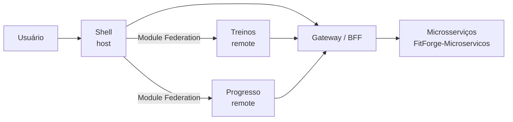

# FitForge — Microfrontend

Aplicação web de academia construída como **SPA React com Webpack Module Federation**. Um *shell* compõe dois microfrontends independentes, **Treinos** e **Progresso**. A versão publicada consome apenas o **Gateway/BFF**; nunca acessa os microsserviços diretamente.

**Integrantes:** Andryus Zolet, Nicolas Medeiros, Valentin Rojas e Leonardo Henrique. Detalhes em [GRUPO.md](GRUPO.md).

## Sumário

- [Links](#links)
- [Visão geral](#visão-geral)
- [Arquitetura](#arquitetura)
- [Estrutura do repositório](#estrutura-do-repositório)
- [Pré-requisitos](#pré-requisitos)
- [Execução local](#execução-local)
- [Scripts disponíveis](#scripts-disponíveis)
- [Testes](#testes)
- [Variáveis de configuração](#variáveis-de-configuração)
- [Deploy na Azure](#deploy-na-azure)
- [Integração com o Gateway](#integração-com-o-gateway)
- [Documentação e entrega](#documentação-e-entrega)
- [Status e limitações](#status-e-limitações)

## Links

| Recurso | Endereço |
| --- | --- |
| video | https://youtu.be/Yu2t_vZOnPY |
| Frontend (Azure) | https://c4pivara35.z21.web.core.windows.net/ |
| Gateway/BFF | https://fitforge-gateway-hvaqcubhf8d0a2hc.chilecentral-01.azurewebsites.net |
| Repositório do Gateway | https://github.com/C4pivara35/FitForge-API_Gateway |
| Repositório do backend | https://github.com/C4pivara35/FitForge-Microservicos |

## Visão geral

| Módulo | Pacote | Responsabilidade |
| --- | --- | --- |
| Shell | `@fitforge/shell` | Aplicação host: layout, navegação, autenticação e composição dos remotes. Visão geral alimentada por `/api/bff/dashboard`. |
| Treinos | `@fitforge/workouts` | Remote: CRUD de treinos e sessões. |
| Progresso | `@fitforge/progress` | Remote: acompanhamento de evolução do aluno. |
| Compartilhado | `packages/shared` | Código comum entre o shell e os remotes. |

## Arquitetura



Decisões principais:

- **Vertical Slice Architecture**, com separação interna de responsabilidades e dependências verificadas por testes automatizados.
- **Frontend desacoplado do backend:** toda comunicação passa pelo Gateway/BFF. O teste de arquitetura garante isso.
- **Gravação confirmada só pela API:** o CRUD só confirma a operação após resposta bem-sucedida do Gateway.
- A aplicação de SOLID e os limites do desenho estão detalhados na [Arc42](docs/ARC42.md).

## Estrutura do repositório

```text
FitForge/
├── apps/                  # shell, workouts (Treinos) e progress (Progresso)
├── packages/shared/       # código compartilhado entre os apps
├── scripts/               # assemble.mjs (monta o dist) e serve.mjs (preview)
├── tests/                 # testes unitários, de arquitetura e de federação
├── .github/workflows/     # pipeline de CI/CD para a Azure
├── docs/                  # Arc42 e checklist de validação
├── GRUPO.md               # integrantes do grupo
├── template.html          # template HTML do shell
└── package.json           # monorepo npm workspaces
```

## Pré-requisitos

- Node.js **22 ou superior**
- npm **10 ou superior**
- Para o modo integrado: Gateway rodando em `8080` e microsserviços em `8081` e `8082` (veja o [repositório do backend](https://github.com/C4pivara35/FitForge-Microservicos))

## Execução local

### Modo integrado (com Gateway)

Na raiz do repositório:

**PowerShell**

```powershell
npm ci
$env:FITFORGE_API_URL = "http://localhost:8080"
$env:FITFORGE_REQUIRE_AUTH = "true"
npm run dev
```

**Bash (Linux/macOS)**

```bash
npm ci
export FITFORGE_API_URL="http://localhost:8080"
export FITFORGE_REQUIRE_AUTH="true"
npm run dev
```

Acesse **http://localhost:5000**. Use as credenciais configuradas no seu Gateway; elas **não** são credenciais de SQL ou da Azure.

### Modo demonstração (sem Gateway)

Sem `FITFORGE_API_URL`, a aplicação roda em modo de demonstração e persiste os dados no armazenamento do navegador. Esse modo serve para desenvolvimento de interface e **não comprova a entrega em nuvem**.

```bash
npm ci
npm run dev
```

## Scripts disponíveis

| Comando | O que faz |
| --- | --- |
| `npm run dev` | Sobe shell, Treinos e Progresso em paralelo com dev servers. |
| `npm run build` | Compila os remotes e o shell e monta o `dist` com `scripts/assemble.mjs`. |
| `npm run build:remotes` | Compila apenas Treinos e Progresso. |
| `npm run build:shell` | Compila apenas o shell. |
| `npm run preview` | Serve o build localmente (`scripts/serve.mjs`). |
| `npm test` | Executa os testes unitários e de regras de arquitetura. |
| `npm run test:integration` | Executa os testes de federação sobre o build. |
| `npm run check` | Pipeline completo: `test` → `build` → `test:integration`. |

## Testes

```bash
npm ci
npm run check
```

Execute em um terminal **sem** `FITFORGE_API_URL` e `FITFORGE_REQUIRE_AUTH` definidas, para validar o build padrão.

O `npm run check` cobre:

- **Testes unitários e de arquitetura:** composição dos remotes, consumo exclusivo do BFF e limites entre adaptadores.
- **Build completo** do shell e dos remotes.
- **Três testes de integração de federação** sobre o build gerado.

## Variáveis de configuração

| Variável | Onde | Descrição |
| --- | --- | --- |
| `FITFORGE_API_URL` | Ambiente local / variável pública do GitHub | URL base do Gateway (HTTPS em produção). |
| `FITFORGE_REQUIRE_AUTH` | Ambiente local / build do workflow | Quando `true`, exige autenticação. O workflow compila com esse valor ativado. |
| `AZURE_STORAGE_CONNECTION_STRING` | Segredo do GitHub | Connection string do Storage usada na publicação. |
| `CORS_ORIGINS` | Configuração do **Gateway** | Deve conter `https://c4pivara35.z21.web.core.windows.net`. |

> Nunca versione a connection string do Storage nem credenciais do Gateway.

## Deploy na Azure

O workflow em `.github/workflows` executa:

1. Instala dependências e roda os testes.
2. Compila com autenticação exigida.
3. Publica o conteúdo de `dist` no contêiner `$web` do Azure Storage.

O Storage hospeda somente os arquivos estáticos; qualquer operação de servidor passa pelo Gateway. Alterações apenas em `README`, `GRUPO` ou `docs/` **não** disparam o deploy.

**Configuração necessária**

- **GitHub:** variável `FITFORGE_API_URL` (URL HTTPS do Gateway) e segredo `AZURE_STORAGE_CONNECTION_STRING`.
- **Gateway:** `CORS_ORIGINS=https://c4pivara35.z21.web.core.windows.net`.

Para Azure SQL, Service Bus e publicação do backend, consulte o [guia de deploy](https://github.com/C4pivara35/FitForge-Microservicos/blob/main/docs/DEPLOY-AZURE.md).

## Integração com o Gateway

| Funcionalidade | Endpoint |
| --- | --- |
| Visão geral (dashboard) | `/api/bff/dashboard` |
| Treinos (CRUD) | `/api/treinos` |
| Sessões (CRUD) | `/api/sessoes` |

## Documentação e entrega

- [Arc42 completa (12 seções)](docs/ARC42.md)
- [Checklist de validação e evidências](docs/VALIDACAO-ENTREGA.md)
- [Guia de Azure SQL, Service Bus e publicação](https://github.com/C4pivara35/FitForge-Microservicos/blob/main/docs/DEPLOY-AZURE.md)
- [Integrantes do grupo](GRUPO.md)

## Status e limitações

- Código e CI aprovados **não** comprovam a ativação de SQL e mensageria; essa conclusão depende da configuração e das evidências na Azure.
- **Vídeo de apresentação:** pendente de gravação e publicação como não listado no YouTube. Inserir o link aqui após validar o fluxo em nuvem, com todos os integrantes falando e com a câmera aberta.
