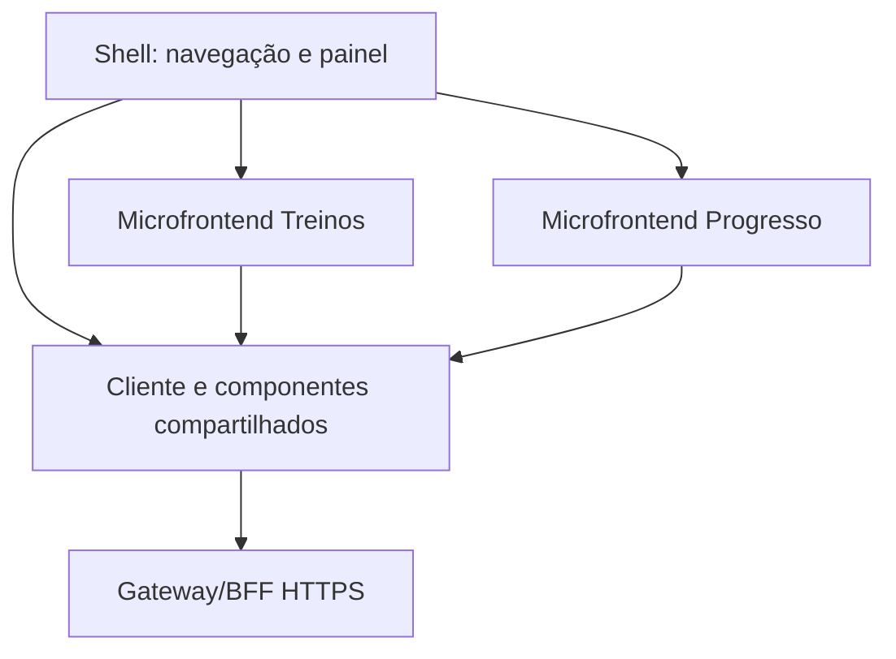

# Arc42 — FitForge Microfrontend

Versão: 1.0 — 17/11/2026. Responsáveis: Andryus Zolet, Nicolas Medeiros, Valentin Rojas e Leonardo Henrique.

Esta documentação descreve a arquitetura implementada e a implantação pretendida. A existência do código não substitui a validação dos recursos na Azure. A evidência operacional deve ser registrada após executar o checklist em [VALIDACAO-ENTREGA.md](VALIDACAO-ENTREGA.md).

## 1. Introdução e objetivos

O FitForge permite planejar fichas com exercícios e registrar sessões realizadas. O frontend apresenta a visão geral, o CRUD de fichas e o CRUD de sessões. Os domínios são entregues por dois microfrontends carregados por um shell. O navegador consome a entrada Gateway/BFF para acessar dados de servidor.

| Interessado | Necessidade |
|---|---|
| Pessoa que treina | Organizar fichas e acompanhar o histórico com confirmação de gravação |
| Grupo de desenvolvimento | Evoluir Treinos e Progresso com limites reconhecíveis no código |
| Professor avaliador | Demonstrar na Azure federação, BFF, CRUD e reflexo nos bancos |
| Responsável pela publicação | Publicar os bundles corretos e acompanhar limitações do plano gratuito |

Objetivos de qualidade, em ordem: integridade das confirmações de gravação, isolamento entre interface e serviços, testabilidade e experiência compreensível em falhas. Não são objetivos desta entrega a prescrição médica, pagamentos ou sincronização offline com o servidor.

## 2. Restrições

React 18, JavaScript, Webpack 5 e Module Federation; Node.js 22 para build. Há três repositórios públicos separados. A hospedagem escolhida é o site estático do Azure Storage; SPA estática não exige um processo Node no servidor. As APIs usam HTTPS. Senhas de bancos, chave interna e credenciais do Service Bus não entram no bundle.

O backend pode usar CosmosDB compatível com MongoDB, conforme o enunciado geral. A rubrica específica menciona Atlas; essa diferença precisa ser alinhada com o professor. O plano gratuito dos App Services impõe cotas e cold start. A Arc42 não afirma disponibilidade contínua nem resultados de desempenho que não foram medidos.

## 3. Contexto e escopo

O limite deste repositório abrange o shell, os microfrontends e os módulos compartilhados. O Gateway, os serviços, os bancos e o broker são sistemas externos a esse limite.

| Interface | Contrato | Uso |
|---|---|---|
| Navegador → Storage | HTTPS, HTML/JavaScript/CSS | Carregar a SPA e os remotes |
| Shell → remotes | `workouts/App`, `progress/App` | Composição em tempo de execução |
| Shell → Gateway | `GET /api/bff/dashboard` | Uma resposta agregada para o painel |
| Treinos → Gateway | `/api/treinos` e `/{id}` | CRUD de fichas |
| Progresso → Gateway | `/api/sessoes` e `/{id}` | CRUD de sessões |
| Front → Gateway | `/api/auth/check`, `/api/auth/register` | Login e cadastro quando configurado |
| Treinos → Gateway | `/api/treinos/{id}/atividade` | Projeção atualizada pelo consumidor do broker |

As referências a MongoDB, Azure SQL e Service Bus nesta documentação explicam o contexto. O frontend não mantém conexões com esses recursos nem usa URLs dos microsserviços.

## 4. Estratégia da solução

O padrão adotado é **Vertical Slice Architecture**, com uma fatia de interface por domínio e infraestrutura compartilhada explícita. O shell cuida da navegação, autenticação e painel. `workouts` e `progress` mantêm suas telas e adaptadores de dados. O cliente compartilhado concentra URL base, autorização e erros HTTP.

O dashboard utiliza o BFF. As operações de escrita aguardam a confirmação HTTP do servidor antes de atualizar a interface como sucesso. O modo local de demonstração é selecionado quando o build não recebe `FITFORGE_API_URL`; ele não representa a persistência da entrega em nuvem. O workflow exige URL HTTPS para o build publicado.

A estrutura segue fatias verticais; não se afirma que o projeto adota Clean Architecture com domínio totalmente independente de frameworks.

## 5. Visão de blocos

| Bloco | Arquivos principais | Responsabilidade |
|---|---|---|
| Shell | `apps/shell/src/App.jsx` | Login, navegação, carregamento e painel agregado |
| Treinos | `apps/workouts/src/App.jsx`, `api.js` | Fichas, exercícios e adaptação para `/api/treinos` |
| Progresso | `apps/progress/src/App.jsx`, `api.js` | Sessões e adaptação para `/api/sessoes` |
| Comunicação | `packages/shared/src/gateway.js` | URL base, autorização e requisição |
| Estado remoto | `packages/shared/src/serverRepository.js` | Confirmar gravações e atualizar o estado observado |
| Regras e componentes | `packages/shared/src/domain.js`, `ui.jsx` | Validação e apresentação reutilizável |
| Build | `scripts/webpack.common.cjs`, `scripts/assemble.mjs` | Federação e montagem do diretório `dist` |

Cada remote é compilado separadamente, embora o workflow atual publique os três artefatos em conjunto no mesmo Storage. Builds separados não significam que a entrega já possui três pipelines independentes.

## 6. Visão de execução

### 6.1 Abertura e autenticação

O navegador recebe `index.html`, carrega o shell e resolve os remotes. Com autenticação exigida, a pessoa informa as credenciais. O cliente envia a verificação ao Gateway por HTTPS. `204` permite seguir; `401` mantém a tela de acesso. As credenciais são mantidas em memória da aba.

### 6.2 Painel

O shell chama `/api/bff/dashboard`. O Gateway valida o acesso, e o BFF consulta os domínios. A resposta inclui fichas, sessões, estatísticas e situação dos serviços. A interface informa indisponibilidade quando a composição não consegue carregar uma dependência. Indicadores visuais derivados, como contar dias ativos dos buckets recebidos, continuam sendo responsabilidade de apresentação.

### 6.3 CRUD e confirmação

Ao salvar uma ficha, o adaptador valida o formulário e envia POST ou PUT ao Gateway. O serviço grava no MongoDB e responde. O repositório remoto atualiza a tela somente após o sucesso. A sessão segue o mesmo fluxo até o Azure SQL. DELETE confirmado remove o item da interface. Uma falha de rede não é apresentada como gravação bem-sucedida.

### 6.4 Projeção assíncrona

Criar sessão gera um evento no backend. Após o consumo, a consulta de atividade da ficha pode apresentar `lastSessionRecordedAt`. A projeção tem consistência eventual: a confirmação SQL da sessão pode chegar antes da atualização MongoDB.

## 7. Visão de implantação

| Ambiente | Frontend | APIs |
|---|---|---|
| Local | shell `localhost:5000`, remotes pelas portas dos scripts | Gateway `localhost:8080` |
| Azure | [Storage do FitForge](https://c4pivara35.z21.web.core.windows.net/) | [Gateway](https://fitforge-gateway-hvaqcubhf8d0a2hc.chilecentral-01.azurewebsites.net) |

GitHub Actions executa instalação, testes, build e teste da federação. Um segundo build recebe `FITFORGE_API_URL` e `FITFORGE_REQUIRE_AUTH=true`. O upload publica os chunks com cache longo e os entrypoints com `no-cache`, reduzindo referências a versões antigas. O conteúdo de `dist` vai ao contêiner `$web`.

`FITFORGE_API_URL` é variável pública de build no GitHub; `AZURE_STORAGE_CONNECTION_STRING` é segredo de publicação no GitHub. `CORS_ORIGINS` fica no App Service do Gateway com a origem exata do Storage. Alterar apenas a variável do GitHub exige novo build para modificar o JavaScript publicado. Alterar Markdown em `docs/`, README ou integrantes não dispara deploy pelo workflow atualizado.

## 8. Conceitos transversais

### Arquitetura e SOLID

| Princípio | Aplicação concreta | Limite conhecido |
|---|---|---|
| SRP | Shell navega; adaptadores acessam dados; regras validam formulários | Componentes de tela ainda concentram bastante apresentação |
| OCP | Repositório aceita funções de requisição/validação sem reescrever cada operação | Não há sistema genérico de plugins de negócio |
| LSP | Função de requisição de teste mantém contrato de resolução/rejeição do cliente real | Compatibilidade é verificada por testes, não por tipos estáticos |
| ISP | Cada microfrontend depende do seu adaptador e contratos utilizados | O pacote compartilhado requer cuidado para não crescer sem limite |
| DIP | Repositório recebe requisição por injeção; testes substituem rede por funções controladas | A interface usa React diretamente, conforme o padrão escolhido |

Erros são tratados conforme HTTP ou indisponibilidade de rede. A origem CORS permitida é definida no Gateway. HTTP Basic depende de HTTPS e não equivale a OAuth/OIDC. A interface não armazena credenciais dos bancos. Validações do frontend melhoram a experiência, mas as regras também precisam existir no servidor.

### Testes e observabilidade

`npm test` executa testes de domínio, acesso remoto e arquitetura. `npm run test:integration` verifica carregamento dos builds federados. `tests/architecture.test.mjs` impede importações cruzadas entre domínios e URLs diretas dos microsserviços nos adaptadores e confirma o consumo do BFF. Essas verificações textuais têm escopo limitado e não substituem análise completa de dependências.

O Network do navegador deve mostrar requisições ao Gateway. `X-Correlation-Id` e `X-Gateway-Route` ajudam a relacionar a requisição com o backend. Logs e telas de demonstração não devem expor Authorization.

## 9. Decisões arquiteturais

| ADR | Decisão e motivo | Consequência |
|---|---|---|
| FE-01 | Module Federation para compor domínios com build separado | Exige compatibilidade das dependências compartilhadas e teste dos remotes |
| FE-02 | Gateway/BFF como entrada única | URL central e possibilidade de agregação; dependência operacional desse componente |
| FE-03 | Dashboard composto no BFF | Regras de composição centralizadas; exige contrato compatível com o shell |
| FE-04 | Confirmar escrita após HTTP bem-sucedido | Evita indicar persistência inexistente; latência fica perceptível |
| FE-05 | Storage para assets estáticos | Hospedagem simples; não executa código de backend |
| FE-06 | Demonstração local explícita sem API | Facilita desenvolvimento; build publicado deve impedir configuração vazia |

## 10. Requisitos de qualidade

Os critérios abaixo são metas de aceitação, e não medições já realizadas.

| Cenário | Estímulo e ambiente | Resposta e medida |
|---|---|---|
| QF-01 Integridade | API rejeita POST durante uso normal | Mostrar erro e não confirmar ficha persistida |
| QF-02 Isolamento | Alteração introduz URL de serviço em um adaptador | Teste de arquitetura falha antes do deploy |
| QF-03 Composição | Pessoa abre Visão geral com serviços disponíveis | Uma chamada de dashboard retorna dados dos dois domínios |
| QF-04 Resiliência | Um serviço está fora durante o painel | Exibir estado de indisponibilidade compatível com o BFF |
| QF-05 Compatibilidade | Build federado atualizado | Três testes de federação passam antes da publicação |
| QF-06 Segurança | Sessão sem credenciais chama API protegida | Gateway responde `401`; credenciais de infraestrutura ausentes do bundle |

Árvore de qualidade: confiabilidade → confirmação de gravação; modificabilidade → fatias de domínio; segurança → entrada HTTPS; testabilidade → cliente injetável. A cota F1 impede assumir uma meta rígida de disponibilidade.

## 11. Riscos e dívida técnica

| Risco | Impacto | Tratamento |
|---|---|---|
| SQL ou broker não configurados na Azure | Interface pode funcionar sem atender aos requisitos de infraestrutura | Executar checklist com inspeção dos bancos e evento |
| Cota/cold start dos App Services | Lentidão ou indisponibilidade durante apresentação | Preparar ambiente e conferir cotas; evitar redeploys repetidos |
| Contratos divergentes entre remotes e BFF | Falha parcial de tela | Testes e publicação coordenada |
| Basic de demonstração | Controle de identidade limitado | HTTPS, chave interna e evolução futura para OIDC |
| Cache de entrypoint incompatível | Remote antigo ou chunk ausente | Publicar chunks antes dos entrypoints e validar carregamento |
| Testes de arquitetura textuais | Dependências indevidas podem escapar | Evoluir análise de imports; manter revisão humana |

Na revisão anterior a esta atualização, Progresso usava H2 e o Service Bus estava desativado. A documentação é concluída com este arquivo; a conclusão da implantação depende das configurações e evidências do checklist. O vídeo permanece pendente até sua publicação.

## 12. Glossário

| Termo | Significado no FitForge |
|---|---|
| Ficha | Plano de exercícios de um ou mais dias |
| Sessão | Registro de treino realizado vinculado a uma ficha |
| Shell | Aplicativo que compõe navegação e microfrontends |
| Remote | Bundle exposto por Module Federation |
| BFF | Backend que compõe a resposta para a interface |
| Gateway | Entrada de roteamento e segurança das APIs |
| Projeção | Estado derivado de evento, como a atividade da ficha |
| Consistência eventual | Intervalo possível entre gravação SQL e atualização MongoDB |

Referência de estrutura: [arc42, visão das 12 seções](https://arc42.org/overview/). Documentação escrita para este projeto, sem reprodução do texto do template.
