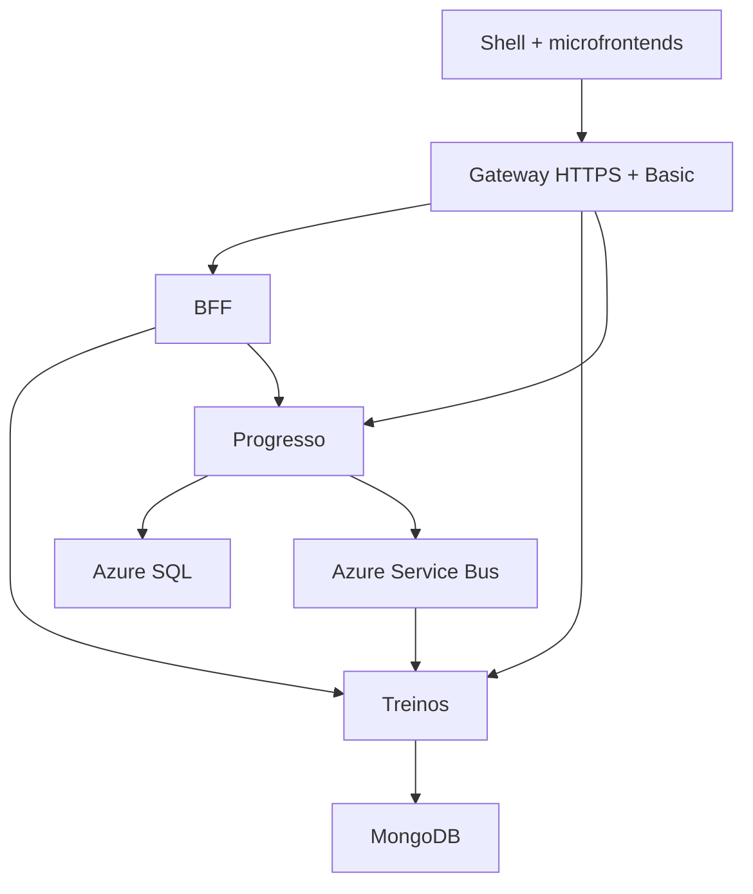

# Arquitetura do FitForge

A documentação arquitetural completa está em [ARC42.md](ARC42.md). Este arquivo mantém uma visão resumida do código; a validação da configuração na nuvem deve seguir [VALIDACAO-ENTREGA.md](VALIDACAO-ENTREGA.md).

## Fatias verticais

- **Frontend:** `apps/workouts` e `apps/progress` são compilados separadamente e expostos por Module Federation. Cada fatia contém a interface e o adaptador de dados do domínio. O shell controla navegação, login e dashboard. O pacote compartilhado contém componentes, validação e o cliente do Gateway.
- **Gateway/BFF:** a fatia `bff` contém o controlador, o serviço de composição, contratos e clientes HTTP. O Gateway executa roteamento, autenticação e CORS como responsabilidades transversais.
- **Backend:** `workouts` e `sessions` reúnem os casos de uso, modelos, adaptadores de API e persistência no respectivo serviço. Os controladores delegam ao serviço. As regras de dependência são verificadas pelo ArchUnit.

Os controladores recebem seus serviços por construtor. O serviço de Progresso registra o evento sem depender do SDK Azure, e o publicador encapsula o envio ao broker. No frontend, o repositório recebe a função de requisição por injeção para testar regras sem rede.

## Escrita e leitura

O frontend publicado acessa o Gateway. Ao abrir **Visão geral**, faz uma chamada para `GET /api/bff/dashboard`. O BFF consulta fichas, sessões e estatísticas em paralelo e devolve a composição com o estado de cada serviço. Para CRUD, o Gateway encaminha as rotas de fichas e sessões. O adaptador do frontend atualiza a interface após a API confirmar a operação.

Os serviços usam bancos separados. Progresso guarda o identificador e o nome da ficha como referência histórica. Ao criar uma sessão com o broker habilitado, a mesma transação SQL grava a sessão e uma outbox. Uma tarefa publica `fitforge.sessao-registrada.v1` no Service Bus. Treinos confirma a mensagem após atualizar o último registro recebido para a ficha, de forma idempotente. Mensagens fora do contrato vão para a fila de mensagens mortas.

## Segurança e evolução

Na Azure, o Gateway valida uma conta de demonstração por HTTP Basic sobre HTTPS e aceita CORS para a origem do frontend configurada. Os serviços validam uma chave interna. A senha do Gateway fica apenas nas configurações do servidor e, durante o uso, em memória na aba do usuário. As credenciais dos bancos e do broker ficam nas variáveis dos App Services.

Os testes cobrem regras de negócio, arquitetura, CRUD, agregação, CORS, autenticação e carregamento dos microfrontends. O modo local de demonstração está disponível quando o frontend é compilado sem API. O deploy em Azure exige Gateway HTTPS.
